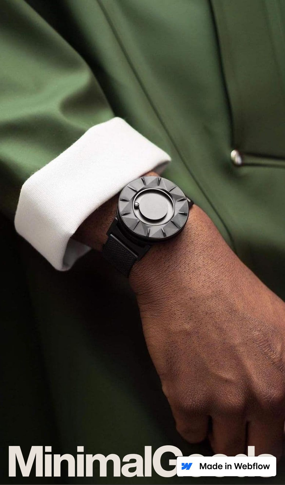
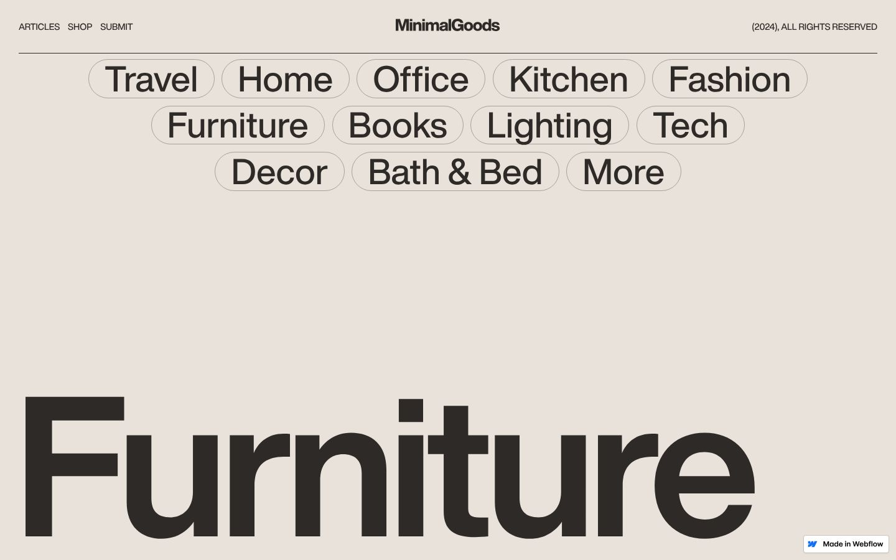
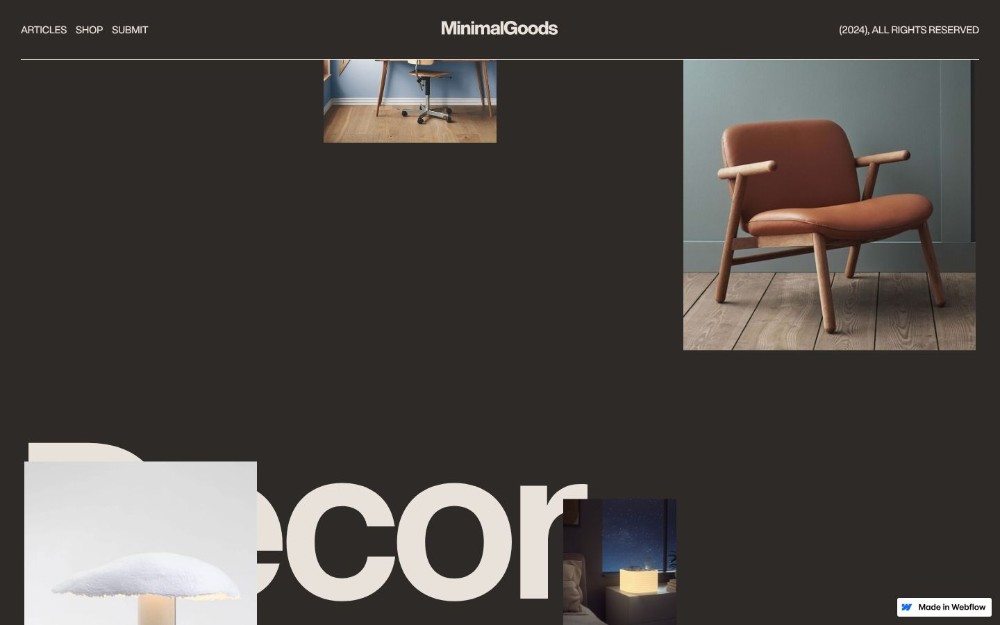

<div align="center">

# MinimalGoods

### Product landing page with GSAP ScrollTrigger animations

A minimal product-curation landing page where scrolling drives everything: the logo shrinks into the navbar, a circle grows to full screen, the page fades between light and dark, and product images move in parallax.

[](https://developer.mozilla.org/docs/Web/HTML)
[](https://developer.mozilla.org/docs/Web/CSS)
[](https://developer.mozilla.org/docs/Web/JavaScript)
[](https://gsap.com)
[](https://gsap.com/docs/v3/Plugins/ScrollTrigger/)
[](https://jquery.com)
<br>
[](https://tiny-lokum-2f9821.netlify.app/)

**[Live demo](https://tiny-lokum-2f9821.netlify.app/)** ·
**[Portfolio](https://new-portfolio-ashy-xi.vercel.app/)** ·
**[LinkedIn](https://www.linkedin.com/in/eslamraafat-dev/)** ·
**[Email](mailto:eslamraafat736@gmail.com)**

<br>


</div>

<table>
  <tr>
    <td width="33%"></td>
    <td width="67%">
      <br><br>
      
    </td>
  </tr>
  <tr>
    <td align="center"><sub>Mobile (iPhone 13)</sub></td>
    <td align="center"><sub>Categories (light) · Product grid after the colour change (dark)</sub></td>
  </tr>
</table>

---

## Overview

A **learning project** for GSAP scroll animations. The page layout is the "MinimalGoods" Webflow showcase site (`minimal-goods.webflow.io`, exported from Webflow, which is why the "Made in Webflow" badge shows). The layout CSS, Webflow runtime and images still load from Webflow's CDN. On top of it, the inline script at the bottom of `index.html` wires up **nine GSAP / ScrollTrigger timelines** that create every scroll effect on the page.

What I practised: `gsap.timeline()` with `scrollTrigger`, `start` / `end` positions, `scrub` smoothing, `from` / `to` / `fromTo` tweens, and `onEnter` / `onEnterBack` callbacks.

## Features

All of these are in the inline `<script>` of `index.html`:

| Effect | How it works |
| --- | --- |
| **Logo scale** | While you scroll through the hero, the full-width wordmark shrinks and moves up into the navbar (`from` tween, `scrub: 1`). |
| **Header text hide** | Each line of the "Discover the best in minimal design" headline slides down out of view as you scroll (`y: 100%`, `scrub: 0.8`). |
| **Sticky circle grow** | A 35em circle image grows into a full-screen `100vw × 100vh` rectangle while its section is pinned with CSS `position: sticky`. |
| **Light ↔ dark colour change** | Odd product groups fade the page and navbar from cream `#e8e2da` to dark `#2e2a27`, and even groups fade back. |
| **Grid title change** | Entering each product group (Furniture, Decor, Office, Tech) swaps the big sticky title using `onEnter` / `onEnterBack`. |
| **Parallax product grid** | Every third image moves at a different speed (`y: -30%`, `-50%`, `-70%` with `scrub` 1, 2 and 1.5) for a layered depth effect. |

Other sections: a fixed navbar (Articles, Shop, Submit) and twelve pill-shaped category links (Travel, Home, Office, Kitchen, Fashion, and more).

## Tech stack

| Layer | Tools |
| --- | --- |
| Markup | HTML5 (single page, Webflow export) |
| Styling | Webflow-generated CSS (loaded from Webflow's CDN) |
| Animation | GSAP 3.8.0 + ScrollTrigger 3.8.0 (cdnjs) |
| Scripting | jQuery 3.5.1 (used to select elements for each timeline) |
| Hosting | Netlify |

## Project structure

```text
.
├── index.html          # markup + the GSAP / ScrollTrigger script at the bottom
└── docs/screenshots/   # images used in this README
```

## Getting started

There is nothing to build:

```bash
git clone https://github.com/Eslamraafat1/GSAP.git
cd GSAP
npx serve .        # or just open index.html
```

An internet connection is needed, because the CSS, images, jQuery and GSAP all load from CDNs.

## Deployment

Hosted on **Netlify**: [tiny-lokum-2f9821.netlify.app](https://tiny-lokum-2f9821.netlify.app/).

## Author

**Eslam Raafat**, Front-End Developer (React · Next.js · TypeScript)

- **Portfolio:** [new-portfolio-ashy-xi.vercel.app](https://new-portfolio-ashy-xi.vercel.app/)
- **LinkedIn:** [linkedin.com/in/eslamraafat-dev](https://www.linkedin.com/in/eslamraafat-dev/)
- **GitHub:** [@Eslamraafat1](https://github.com/Eslamraafat1)
- **Email:** [eslamraafat736@gmail.com](mailto:eslamraafat736@gmail.com)
